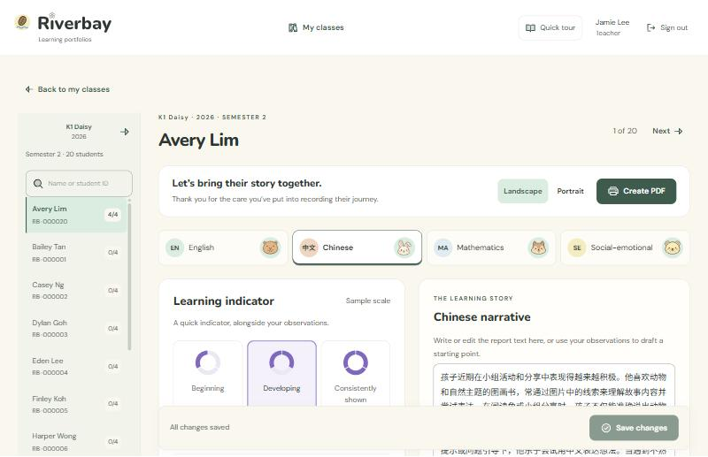

# Riverbay learning portfolios

A teacher workspace for preschool learning portfolios. Teachers record observations, draft each narrative with AI, and export a bilingual PDF for parents. Built as a working prototype for a preschool portfolio brief, with fictional data only.



**Live demo:** https://riverbay-portfolio.vercel.app

| Account | Email |
|---|---|
| Teacher | teacher@riverbay.com |
| Second teacher | teacher2@riverbay.com |
| Administrator | admin@riverbay.com |

All demo accounts use the password `teach2LEARN`. Riverbay Preschool, its children and its photos are fictional.

## Highlights

- **Four learning domains per child per semester:** English, Chinese, Mathematics and Social-emotional, each with an indicator, dated observations, a narrative and photos.
- **AI drafting with the teacher in control.** The AI drafts the narrative from the teacher's observations only. Names, student IDs and photos are never sent. Nothing changes until the teacher accepts and saves. The provider is replaceable: Gemini, OpenAI and Groq adapters, with a local Qwen model benchmarked.
- **Bilingual PDF.** English and Simplified Chinese, portrait or landscape, fonts embedded, rendered by headless Chrome on Vercel.
- **Progress across the year.** Semester 2 shows each Semester 1 indicator beside the current one.
- **Fast class workflow.** Domains switch in the browser, neighbouring students load in the background, and an unsaved-changes guard protects typing.
- **Access control.** Supabase Auth, row-level security, private photo storage with short-lived links, and an administration workspace for classes, students and teachers.
- **Small touches:** page tours, loaders and two hidden easter eggs.

## Tech stack

| Layer | Choice |
|---|---|
| App | Next.js 16 (App Router), React, TypeScript, Tailwind |
| Data, login and files | Supabase: PostgreSQL with row-level security, Auth, private Storage |
| AI | Server-side drafting adapter; Gemini 3.1 Flash-Lite in the demo |
| PDF | HTML/CSS template printed by headless Chrome (`@sparticuz/chromium` on Vercel) |
| Hosting | Vercel (Singapore) and Supabase (Singapore) |

## Run locally

Prerequisites: Node.js 22, npm, and Docker Desktop with Linux containers.

```powershell
npm ci
npm run db:start
node node_modules/supabase/dist/supabase.js migration up --local
npm run setup:local
npm run dev
```

Open http://127.0.0.1:3000. Local setup creates an administrator and two teachers with fictional classes, and writes the demo password to the ignored file `.demo-access.txt`. PDF export needs a local Chrome or Edge.

Checks:

```powershell
npm run lint
npm run typecheck
npm run build
npm run test:access
```

`test:access` runs only against the local database. It checks class isolation, denied direct writes, archiving and private storage with disposable records.

## Documentation

| Topic | Document |
|---|---|
| Data model and access rules | [docs/ARCHITECTURE.md](docs/ARCHITECTURE.md) |
| AI drafting: request, response, limits | [docs/AI_DRAFTING.md](docs/AI_DRAFTING.md) |
| Deploying to Vercel and Supabase | [docs/DEPLOYMENT_HANDOFF.md](docs/DEPLOYMENT_HANDOFF.md) |
| PDF template and renderer | [docs/pdf-concepts/claude/README.md](docs/pdf-concepts/claude/README.md) |
| Model benchmarks (local Qwen, cloud models) | [benchmarks/temporal/RESULTS.md](benchmarks/temporal/RESULTS.md), [benchmarks/live-classroom/RESULTS.md](benchmarks/live-classroom/RESULTS.md) |
| Class, student and teacher administration | [docs/CLASS_ADMINISTRATION.md](docs/CLASS_ADMINISTRATION.md) |
| Design direction and motion | [docs/DESIGN_DIRECTION.md](docs/DESIGN_DIRECTION.md), [docs/design-concepts/motion/README.md](docs/design-concepts/motion/README.md) |
| Postponed work | [docs/DEFERRED_FEATURES.md](docs/DEFERRED_FEATURES.md) |
| Development history | [docs/HISTORY.md](docs/HISTORY.md) |

## Status

A prototype, not a production system. Not built yet: a formal teacher review step, school-specific wording checks for the AI, English reference translations, email invitations and password resets. The free hosting plans and the free AI tier are for fictional data only.
