<a id="readme-top"></a>

<!-- PROJECT LOGO -->

<br />
<div align="center">
  <a href="https://github.com/Doraemon-00/riverbay-portfolio">
    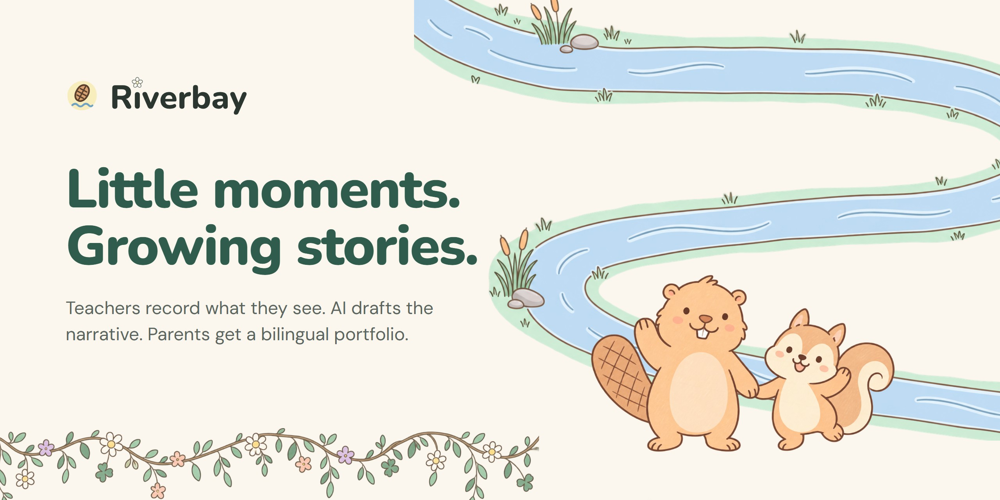
  </a>

  <h3>Riverbay</h3>

  <p>
    A teacher workspace for preschool learning portfolios. Teachers record what they see, AI drafts the narrative from those notes, and parents get a bilingual PDF.
    <br />
    <a href="https://riverbay-portfolio.vercel.app"><strong>Live Demo &rarr;</strong></a>
    &middot;
    <a href="#screenshots">Screenshots</a>
    &middot;
    <a href="https://github.com/Doraemon-00/riverbay-portfolio/issues/new?labels=bug">Report a Bug</a>
    <br />
  </p>

[![Next.js][nextjs-badge]][nextjs-url]
[![React][react-badge]][react-url]
[![TypeScript][typescript-badge]][typescript-url]
[![Tailwind CSS][tailwindcss-badge]][tailwindcss-url]
[![Supabase][supabase-badge]][supabase-url]
[![PostgreSQL][postgresql-badge]][postgresql-url]
[![Google Gemini][gemini-badge]][gemini-url]
[![Headless Chrome][chrome-badge]][chrome-url]
[![Zod][zod-badge]][zod-url]
[![Vercel][vercel-badge]][vercel-url]

</div>

<!-- TABLE OF CONTENTS -->

## Table of Contents

<details>
  <summary>Expand</summary>
  <ol>
    <li>
      <a href="#about-the-project">About The Project</a>
      <ul>
        <li><a href="#screenshots">Screenshots</a></li>
        <li><a href="#how-it-works">How It Works</a></li>
        <li><a href="#features">Features</a></li>
        <li><a href="#architecture">Architecture</a></li>
        <li><a href="#project-structure">Project Structure</a></li>
        <li><a href="#tech-stack">Tech Stack</a></li>
      </ul>
    </li>
    <li>
      <a href="#getting-started">Getting Started</a>
      <ul>
        <li><a href="#demo-accounts">Demo Accounts</a></li>
        <li><a href="#prerequisites">Prerequisites</a></li>
        <li><a href="#installation">Installation</a></li>
        <li><a href="#run-tests">Run Tests</a></li>
      </ul>
    </li>
    <li><a href="#documentation">Documentation</a></li>
    <li><a href="#roadmap">Roadmap</a></li>
    <li><a href="#team">Team</a></li>
    <li><a href="#license">License</a></li>
    <li><a href="#acknowledgments">Acknowledgments</a></li>
  </ol>
</details>

<!-- ABOUT THE PROJECT -->

## About The Project

Every semester, preschool teachers write a learning portfolio for each child: an indicator and a narrative for each learning domain, in English and Chinese, with photos. The narratives come from weeks of observations kept in notebooks and chat threads, and writing them takes up much of a reporting period.

Riverbay keeps the observations, the indicators and the narratives in one place. A teacher records dated observations as they happen. When it is time to report, the AI drafts each narrative from that domain's observations only, and the teacher edits and saves it. Semester 2 shows each Semester 1 indicator beside the current one, so progress across the year is visible. One click prints the finished portfolio as a bilingual PDF for parents.

Built in October 2026 as a working prototype for a preschool's portfolio brief. Riverbay Preschool, its children, its staff and its photos are fictional.

<p align="right"><a href="#readme-top">&uarr;</a></p>

### Screenshots

<table>
  <tr>
    <td width="50%" valign="top" align="left">
      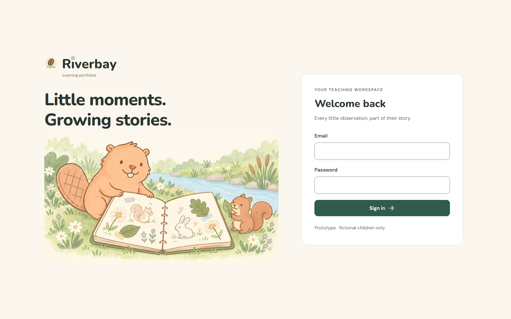
      <br />
      <strong>Sign In</strong> · Teachers and administrators sign in to one workspace. The demo holds fictional children only.
    </td>
    <td width="50%" valign="top" align="left">
      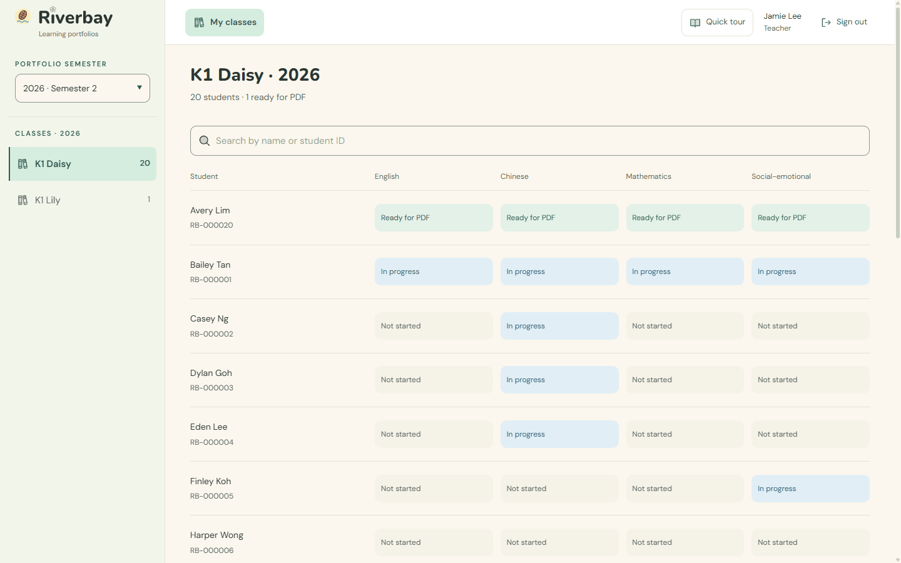
      <br />
      <strong>My Classes</strong> · The semester and classes on the left; each student's four domains at a glance: not started, in progress, or ready for the PDF.
    </td>
  </tr>
  <tr>
    <td width="50%" valign="top" align="left">
      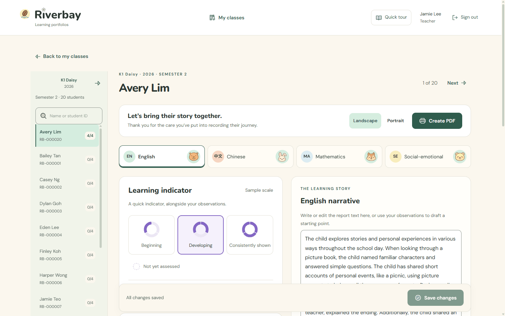
      <br />
      <strong>Portfolio Editor</strong> · The semester and the class’s students on the left, then the four domain tabs, the indicator and the narrative.
    </td>
    <td width="50%" valign="top" align="left">
      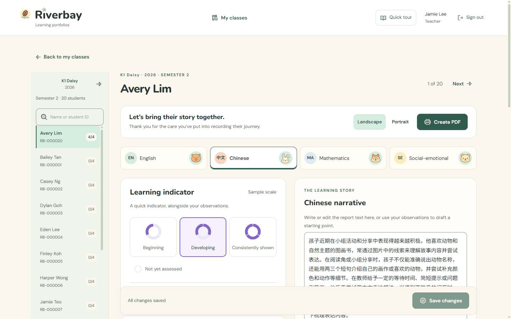
      <br />
      <strong>Chinese Domain</strong> · Observations, drafts and the narrative are in Simplified Chinese for the Chinese domain.
    </td>
  </tr>
  <tr>
    <td width="50%" valign="top" align="left">
      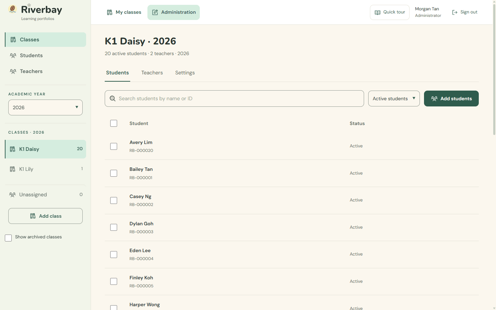
      <br />
      <strong>Administration</strong> · Sections, academic year and classes on the left; students, teachers and settings for the chosen class.
    </td>
    <td width="50%" valign="top" align="left">
      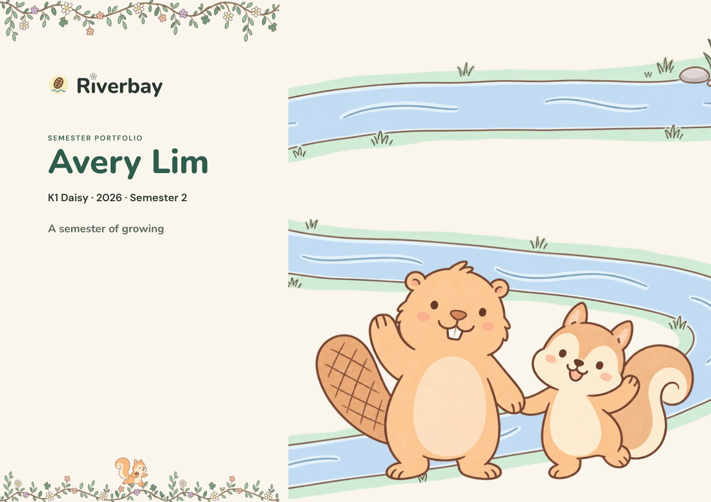
      <br />
      <strong>The PDF</strong> · The cover of a finished portfolio, in landscape. Portrait is one click away.
    </td>
  </tr>
</table>

<p align="right"><a href="#readme-top">&uarr;</a></p>

### How It Works

One student's English domain in Semester 2, as the screenshots show it.

1.  **Record what you see.** Add observations as they happen, each with the date it happened. Rough notes are fine, and undated notes go under General observations.

    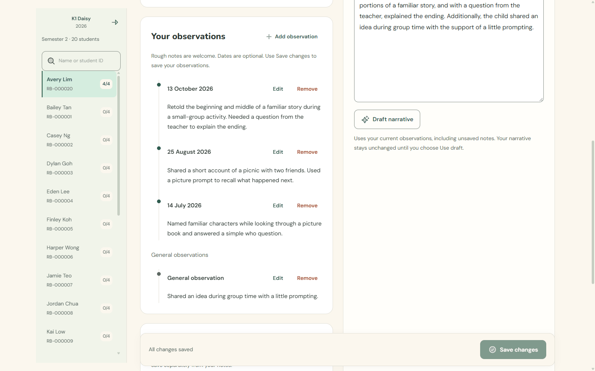

2.  **Draft the narrative.** Press **Draft narrative**. The AI reads only this domain's observations and indicator, never the child's name, student ID or photos, and proposes one paragraph. Nothing changes until the teacher presses **Use draft** and saves.

    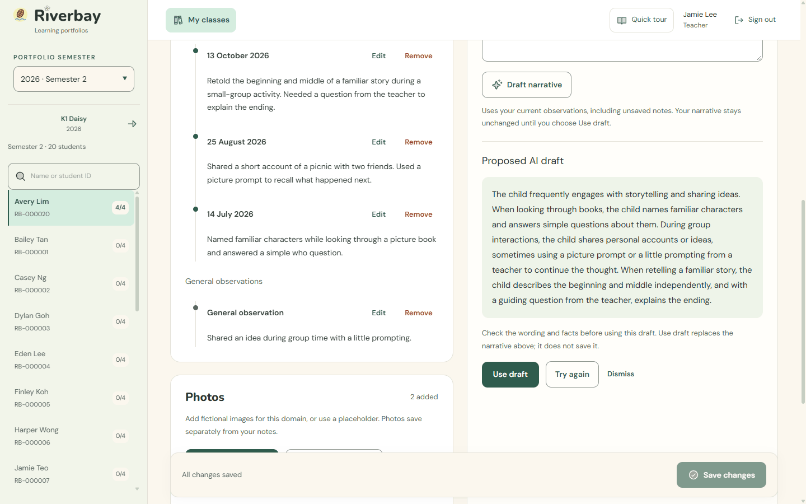

3.  **Pick the indicator.** Choose Beginning, Developing or Consistently shown. In Semester 2, the Semester 1 indicator sits below the choices, and **View Semester 1 report** opens that semester on the same domain, with **Back to Semester 2 report** in the same spot to return.

    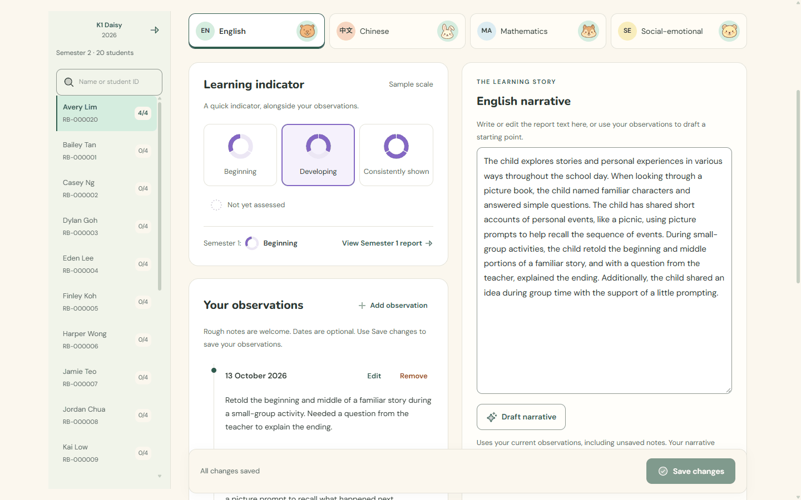

4.  **Add photos.** Upload photos or use a placeholder illustration. Photos are resized, stripped of camera data and stored privately. The PDF holds up to 4 photos per domain.

    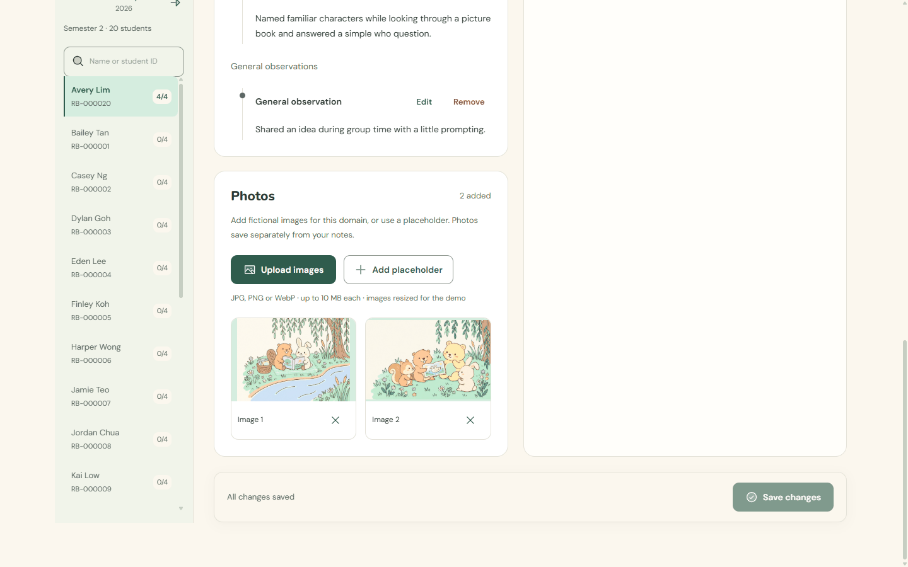

5.  **Create the PDF.** Once all four domains have an indicator and a narrative, choose Landscape or Portrait and press **Create PDF**. Each domain gets its own page, with both semesters' indicators side by side.

    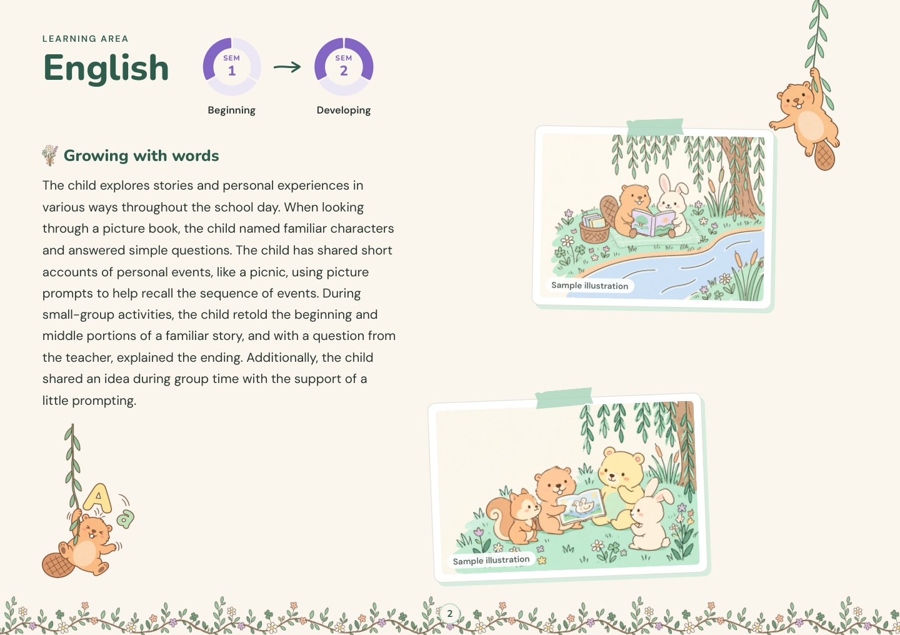

<p align="right"><a href="#readme-top">&uarr;</a></p>

### Features

- **Four learning domains:** English, Chinese, Mathematics and Social-emotional, each with an indicator, dated observations, a narrative and photos, for every child in every semester.
- **AI drafting with the teacher in charge:** the AI writes from the teacher's observations only, keeps support needs and frequency words as written, and asks for more detail when the notes are too thin. The provider is replaceable: Gemini, OpenAI and Groq adapters, with a local Qwen model benchmarked.
- **Progress across the year:** Semester 2 shows each Semester 1 indicator, links to the Semester 1 report and back, and prints both rings in the PDF. A semester picker opens the same student in another semester.
- **Bilingual PDF:** English and Simplified Chinese, landscape or portrait, with fonts embedded and a check that no Chinese character falls back to an empty box.
- **Fast class workflow:** domains switch in the browser, neighbouring students load in the background, My classes reopens the last class you worked in, and an unsaved-changes guard protects typing.
- **One layout everywhere:** on wide screens, the logo heads a left column with each page's own list, and the top bar stays the same on every page. Phones keep a compact top layout.
- **Access control:** Supabase Auth with administrator and teacher roles, row-level security on every table and photo path, and private storage with expiring links.
- **Administration:** classes, students and teacher accounts by school year, with archiving instead of deletion.
- **Small touches:** a quick tour on every page, river-animal loaders and two hidden easter eggs.

<p align="right"><a href="#readme-top">&uarr;</a></p>

### Architecture

<picture>
  <source media="(prefers-color-scheme: dark)" srcset="/docs/readme/architecture-dark.svg">
  <source media="(prefers-color-scheme: light)" srcset="/docs/readme/architecture-light.svg">
  
</picture>

One Next.js app on Vercel serves the pages and does all the server work. Every save, draft and export runs on the server as the signed-in teacher, so Supabase's row-level security decides what each request can read or change. Photos go straight from the browser to private Supabase Storage under the same rules. Drafting sends one domain's observations to Gemini and gets back a fixed JSON shape: a narrative or a question for the teacher. PDF export fills an HTML template and prints it with headless Chrome inside the Vercel function. [ARCHITECTURE.md](/docs/ARCHITECTURE.md) explains the data model and access rules.

Made with [Archify](https://github.com/tt-a1i/archify) from [`architecture.json`](/docs/readme/architecture.json).

<p align="right"><a href="#readme-top">&uarr;</a></p>

### Project Structure

```text
.
├── src/
│   ├── app/            # (workspace) pages in one shared frame, server actions and API routes
│   ├── components/     # Portfolio editor, class list, administration, loaders and tours
│   └── lib/            # Access checks, AI provider, PDF export and portfolio rules
├── supabase/
│   └── migrations/     # Schema, row-level security and storage policies
├── scripts/            # Local setup, fictional demo data and access checks
├── public/assets/      # Logo, indicator rings, characters and fonts
├── benchmarks/         # Model benchmarks: local Qwen and cloud models
├── docs/
│   ├── pdf-concepts/   # PDF template, art and renderer
│   ├── readme/         # This README's images and architecture source
│   └── *.md            # Architecture, AI drafting, deployment and design notes
├── .env.example        # Environment variables
├── vercel.json         # Vercel region (Singapore)
└── README.md
```

<p align="right"><a href="#readme-top">&uarr;</a></p>

### Tech Stack

- **Frontend:** TypeScript, [React](https://react.dev/) 19 and [Next.js](https://nextjs.org/) 16 (App Router), [Tailwind CSS](https://tailwindcss.com/), [Motion](https://motion.dev/) for small transitions, [driver.js](https://driverjs.com/) for the quick tours and [React DayPicker](https://daypicker.dev/) for dates.
- **Backend:** Next.js route handlers and server actions, with [Zod](https://zod.dev/) checking every request.
- **Database, sign-in and files:** [Supabase](https://supabase.com/): PostgreSQL with row-level security, Auth and private Storage.
- **AI:** [Google Gemini](https://ai.google.dev/) 3.1 Flash-Lite behind one replaceable drafting adapter.
- **PDF:** an HTML and CSS template printed by headless Chrome, using [`@sparticuz/chromium`](https://github.com/Sparticuz/chromium) on Vercel.
- **Hosting:** [Vercel](https://vercel.com/) and Supabase, both in Singapore.

<p align="right"><a href="#readme-top">&uarr;</a></p>

<!-- GETTING STARTED -->

## Getting Started

No setup is needed to try Riverbay: open the [live demo](https://riverbay-portfolio.vercel.app) and sign in with a demo account. After you sign in, press **Quick tour** in the top bar for a short tour of each page.

<p align="right"><a href="#readme-top">&uarr;</a></p>

### Demo Accounts

| Account | Email | What you see |
|---|---|---|
| Teacher | teacher@riverbay.com | K1 Daisy, a class of 20 fictional children, and K1 Lily |
| Second teacher | teacher2@riverbay.com | K1 Daisy only. Teachers see only their assigned classes. |
| Administrator | admin@riverbay.com | Classes, students and teacher accounts |

All demo accounts use the password `teach2LEARN`.

To explore without an account, press **Sign in as guest**. It opens a separate copy of the school as its administrator, shared with other visitors and reset every day at 3am SGT. Changes there never reach the accounts above.

<p align="right"><a href="#readme-top">&uarr;</a></p>

### Prerequisites

- [Node.js](https://nodejs.org/) 22 and npm.
- [Docker Desktop](https://www.docker.com/products/docker-desktop/) with Linux containers, for the local Supabase stack.
- Google Chrome or Microsoft Edge, for PDF export on your machine.
- A [Gemini API key](https://ai.google.dev/), only for AI drafting. Set it in `.env.local`; [`.env.example`](/.env.example) lists every variable.

<p align="right"><a href="#readme-top">&uarr;</a></p>

### Installation

1.  **Clone and install.**

    ```sh
    git clone https://github.com/Doraemon-00/riverbay-portfolio.git
    cd riverbay-portfolio
    npm ci
    ```

2.  **Start the local database and apply the schema.**

    ```sh
    npm run db:start
    node node_modules/supabase/dist/supabase.js migration up --local
    ```

3.  **Create the demo data.** This creates an administrator, two teachers and their fictional classes, and writes the demo password to the ignored file `.demo-access.txt`.

    ```sh
    npm run setup:local
    ```

4.  **Start the app,** then open [http://127.0.0.1:3000](http://127.0.0.1:3000).

    ```sh
    npm run dev
    ```

[DEPLOYMENT_HANDOFF.md](/docs/DEPLOYMENT_HANDOFF.md) covers deploying your own copy to Vercel and Supabase.

<p align="right"><a href="#readme-top">&uarr;</a></p>

### Run Tests

```sh
npm run lint
npm run typecheck
npm run build
npm run test:access
npm run test:guest
```

`test:access` runs only against the local database. It checks class isolation, denied direct writes, archiving and private storage with disposable records. `test:guest` (with `npm run dev` running) checks that the guest school and the staff school stay apart, and that the nightly reset restores the guest school.

<p align="right"><a href="#readme-top">&uarr;</a></p>

## Documentation

| Topic | Document |
|---|---|
| Data model and access rules | [ARCHITECTURE.md](/docs/ARCHITECTURE.md) |
| AI drafting: request, response, limits | [AI_DRAFTING.md](/docs/AI_DRAFTING.md) |
| Deploying to Vercel and Supabase | [DEPLOYMENT_HANDOFF.md](/docs/DEPLOYMENT_HANDOFF.md) |
| PDF template and renderer | [pdf-concepts/claude/README.md](/docs/pdf-concepts/claude/README.md) |
| Model benchmarks (local Qwen, cloud models) | [temporal](/benchmarks/temporal/RESULTS.md), [live classroom](/benchmarks/live-classroom/RESULTS.md) |
| Class, student and teacher administration | [CLASS_ADMINISTRATION.md](/docs/CLASS_ADMINISTRATION.md) |
| Design direction and motion | [DESIGN_DIRECTION.md](/docs/DESIGN_DIRECTION.md), [motion](/docs/design-concepts/motion/README.md) |
| Development history | [HISTORY.md](/docs/HISTORY.md) |

<p align="right"><a href="#readme-top">&uarr;</a></p>

<!-- ROADMAP -->

## Roadmap

Riverbay is a prototype, not a production system. Not built yet: a formal teacher review step, school-specific wording checks for the AI, English reference translations of Chinese text, email invitations and password resets. The free hosting plans and the free AI tier are for fictional data only. [DEFERRED_FEATURES.md](/docs/DEFERRED_FEATURES.md) lists every postponed item and when to revisit it.

<p align="right"><a href="#readme-top">&uarr;</a></p>

## Team

Designed and built by [Jun Song](https://github.com/Doraemon-00).

<p align="right"><a href="#readme-top">&uarr;</a></p>

<!-- LICENSE -->

## License

This repository has no open-source licence yet: all rights reserved. The Riverbay name, characters and illustrations were made for this prototype. Third-party libraries and fonts keep their own licences.

<p align="right"><a href="#readme-top">&uarr;</a></p>

<!-- ACKNOWLEDGMENTS -->

## Acknowledgments

- [Next.js](https://nextjs.org/) and [Vercel](https://vercel.com/): the app framework and its hosting.
- [Supabase](https://supabase.com/): the database, sign-in and file storage.
- [Google Gemini](https://ai.google.dev/): the drafting model in the demo.
- [`@sparticuz/chromium`](https://github.com/Sparticuz/chromium): headless Chrome inside a Vercel function.
- [Nunito](https://fonts.google.com/specimen/Nunito), [DM Sans](https://fonts.google.com/specimen/DM+Sans) and [Noto Sans SC](https://fonts.google.com/noto/specimen/Noto+Sans+SC), under the SIL Open Font License.
- [driver.js](https://driverjs.com/) and [React DayPicker](https://daypicker.dev/)
- [Archify](https://github.com/tt-a1i/archify)
- [Shields.io](https://shields.io)

<p align="right"><a href="#readme-top">&uarr;</a></p>

<!-- MARKDOWN LINKS & IMAGES -->

[nextjs-badge]: https://img.shields.io/badge/Next.js-000000?style=for-the-badge&logo=nextdotjs&logoColor=white
[nextjs-url]: https://nextjs.org/
[react-badge]: https://img.shields.io/badge/React-61DAFB?style=for-the-badge&logo=react&logoColor=black
[react-url]: https://react.dev/
[typescript-badge]: https://img.shields.io/badge/TypeScript-3178C6?style=for-the-badge&logo=typescript&logoColor=white
[typescript-url]: https://www.typescriptlang.org/
[tailwindcss-badge]: https://img.shields.io/badge/Tailwind_CSS-06B6D4?style=for-the-badge&logo=tailwindcss&logoColor=white
[tailwindcss-url]: https://tailwindcss.com/
[supabase-badge]: https://img.shields.io/badge/Supabase-3FCF8E?style=for-the-badge&logo=supabase&logoColor=black
[supabase-url]: https://supabase.com/
[postgresql-badge]: https://img.shields.io/badge/PostgreSQL-4169E1?style=for-the-badge&logo=postgresql&logoColor=white
[postgresql-url]: https://www.postgresql.org/
[gemini-badge]: https://img.shields.io/badge/Google_Gemini-8E75B2?style=for-the-badge&logo=googlegemini&logoColor=white
[gemini-url]: https://ai.google.dev/
[chrome-badge]: https://img.shields.io/badge/Headless_Chrome-4285F4?style=for-the-badge&logo=googlechrome&logoColor=white
[chrome-url]: https://developer.chrome.com/docs/chromium/headless
[zod-badge]: https://img.shields.io/badge/Zod-408AFF?style=for-the-badge&logo=zod&logoColor=white
[zod-url]: https://zod.dev/
[vercel-badge]: https://img.shields.io/badge/Vercel-000000?style=for-the-badge&logo=vercel&logoColor=white
[vercel-url]: https://vercel.com/
