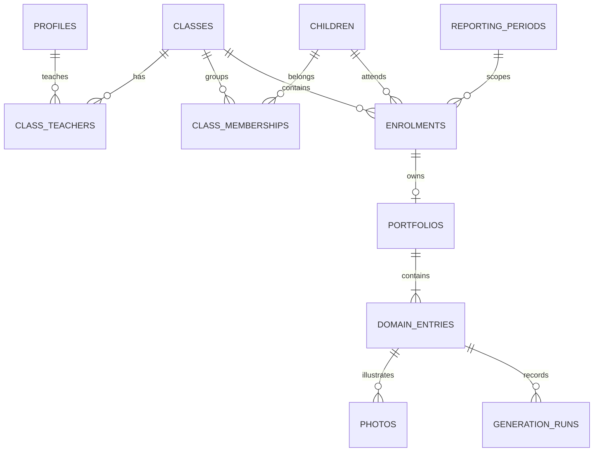

# Riverbay architecture

Status: local editor, AI/photo integration and PDF export checkpoint, 22 October 2026. Fictional data only. See README for verified capabilities and setup.

## Scope and assumptions

One developer builds an internal teacher workspace for one preschool; no 12-month engineering headcount is assumed. Local development changes as needed; deployment cadence is not a production commitment. Zero paid hosting commitment for the prototype. A hosted fictional-data demo is the preferred delivery target (19 October); exact vendor is deferred until the PDF/model runtime can be tested in an early deployment slice. Retain local run instructions. No availability SLA yet. Initial measured targets for later profiling: ordinary save API p95 < 1000 ms locally (excluding AI/uploads/PDF), mobile LCP < 2.5 s / INP < 200 ms / CLS < 0.1; these are targets, not measured results. Production budget and SLO require school agreement. Do not block the prototype on speculative scale planning.

## Components

- Next.js App Router + TypeScript: forms, server actions, access-aware queries.
- Supabase: PostgreSQL, password login, private object storage. Local CLI stack for development; the same migrations can be applied to an approved hosted project. Local CLI is not a production self-host deployment.
- Authenticated server client uses the user's session, preserving database row-level security. Service-role credentials are restricted to local setup and disposable test fixtures, never the web application.
- Server-only narrative adapter: current domain observations and a trusted baseline prompt produce a candidate narrative or a clarification. Gemini is the locally verified development provider; OpenAI/Groq adapters have contract checks but no live verification. The teacher explicitly accepts and saves a candidate. The baseline prompt is not school-specific guideline enforcement. Provider choice stays outside the portfolio schema and PDF renderer; benchmarks remain synthetic evidence, not production acceptance.
- Export adapter (connected locally): saved report data -> the selected renderer under docs/pdf-concepts/claude -> Chromium PDF, with locally bundled Chinese fonts and private stored downloads. Canva would be another adapter over the same data, not a replacement database.
- UI direction: Riverbay Preschool, Riverbank Garden, pastel marker doodles, beaver mascot. Dark readable text and uncluttered forms. Selected sign-in artwork is applied; report artwork remains provisional.

## Relationships

One enrolment per child/reporting period; one portfolio per enrolment; one entry per portfolio/domain. A ring is nullable (unassessed) or 1..3 and directly selected, never calculated. Domains: english, chinese, mathematics, social_emotional. English output except the Chinese domain is confirmed by the school; Chinese feedback reviewers can read Chinese.

## Access and administration

Profiles have admin/teacher roles. Roles are provisioned by a trusted seed/invitation process; no public registration or teacher-controlled role changes. Admins manage annual classes, student membership, bulk teacher access, creation and reversible archiving. Account invitations and bulk file imports remain future work; there is no permanent child/portfolio deletion control.

Teacher access derives from annual class assignment plus current student membership; archived children and classes are excluded. Policies cover portfolios, entries, generation metadata and photo records/objects. Assignment removal revokes subsequent access; server reads are uncached. Existing signed URLs may remain valid until expiry, so keep expiry short when uploads are connected. Profile names visible to teachers are limited to their own profile; admin sees all.

An enrolment stores semester content, while membership is annual. Moving a student updates grouping/access for both semesters in that academic year, preserving portfolio IDs and content. Other years are unchanged. Unassignment, class clearing and archiving retain stored portfolio records while denying teacher access as appropriate. Administrator-only access to retained records remains available through the data layer; an issued-PDF history UI is not yet implemented.

Semester 2 reads only the same child's same-year Semester 1 ratings through a narrow database function after authorizing access to Semester 2. That function returns only ratings. Independently, annual class membership authorises the assigned teachers to open either semester's editor for the same year; it does not grant unrelated years' access. Missing prior ratings remain null. Current sample scale is versioned; future changed scales must be treated as incompatible rather than blindly compared.

## Saving and narrative lifecycle

Domain entries carry a revision number. Saves use compare-and-swap with the expected revision, return a conflict for stale edits, and clear review when content changes. Editing is allowed without AI. Input and narrative remain separate fields. AI responses are tied to the captured revision and input snapshot before acceptance. Durable generation-run/provenance storage remains deferred; the current UI response is not an audit history.

AI suggestions, photos and PDF export are connected; formal review and school-specific checks remain deferred. PDF export uses current saved records without AI rewriting and requires an indicator plus narrative in every domain. Saving incomplete work is allowed. Photo operations save separately. The prototype retains only the latest exported file; immutable report/version retention, atomic export snapshots, concurrent-export coordination and production approval rules remain future work.

## Boundaries

No photo analysis, assessment inference, Canva editor, background agents, training, vector database or separate Python service. Template layout changes do not require database changes unless new content fields are introduced. Store private object keys, not expiring URLs. Do not log raw notes, names, prompts or provider keys in generic logs.

Official references consulted 18 October 2026:

- https://nextjs.org/docs/app/getting-started/installation
- https://supabase.com/docs/guides/local-development
- https://supabase.com/docs/guides/database/postgres/row-level-security

## Annual administration update — 19 October 2026

The annual membership model and administrator RPCs in `202610190001_annual_administration.sql` and `202610190002_membership_scope.sql` supersede semester-scoped teacher assignment in the original foundation. Class identity includes academic year. Current class membership and teacher access are annual; content remains stored per semester. See CLASS_ADMINISTRATION.md for migration reconciliation, archive scope and retained records.

## School-wide administration directories

Migration `202610190003_people_directory.sql` adds stable generated student references, active staff status and membership access flags. Historical class membership is retained separately from permission to reopen it after restoration. `manage_class` wraps the private annual implementation; `manage_directory` validates teacher-only activation targets and atomically replaces class assignments within a year. Both check active administrator status and serialize administration transactions. Deactivated staff are denied by request authentication and the RLS helper chain, including existing access tokens and photo storage checks. The frontend uses one Administration workspace with local section switching and shared directory/dialog controls. See CLASS_ADMINISTRATION.md for full restore and activation behaviour.

## Teacher provisioning

`provision-teacher.ts` is server-only and checks active administrator identity before using the server account key. Supabase Auth creates a demo account with the shared demo password `teach2LEARN` and trusted provisioning-actor metadata. The acting administrator's session calls `finish_teacher_setup` to validate that marker and atomically insert a teacher profile plus active class assignments for the selected year. The RPC rechecks active administrator status, does not overwrite existing profiles and never accepts a caller-selected role. Failure triggers compensation against only that request's new auth user. Demo credentials are returned to the authorised administrator; they are not logged, emailed, or stored in application tables. The prototype does not force password expiry/change; verified invitations, recovery and password setup are production follow-ups.

## Request performance

Measured on the hosted demo (22 October 2026): Vercel functions and Supabase both run in Singapore, so the network between them is not the cost. Each portfolio switch took about 0.55-0.7 s, almost all of it server-side data loading. Changes made:

- Domain tabs switch in the browser. All four domain entries of the open portfolio are already loaded, so a tab updates the address bar (`history.pushState`) and swaps the editor without a server request. The unsaved-changes guard still intercepts the click first; after Save or Discard, a switch within the same portfolio also stays in the browser. Saving still re-renders the page through `revalidatePath`, so stamps and saved text stay current.
- Sign-in checks use `getClaims`, which verifies the access token locally with the project's asymmetric signing keys instead of calling Supabase Auth on every request. A revoked session remains valid until its token expires (about an hour); archived staff are still refused by the profile check and the database policies.
- The portfolio page runs the staff check alongside one query that finds the enrolment by portfolio ID, instead of three requests in sequence.
- Class navigation loads only names, classes and each classmate's ready-for-PDF count, not every classmate's notes and stories.
