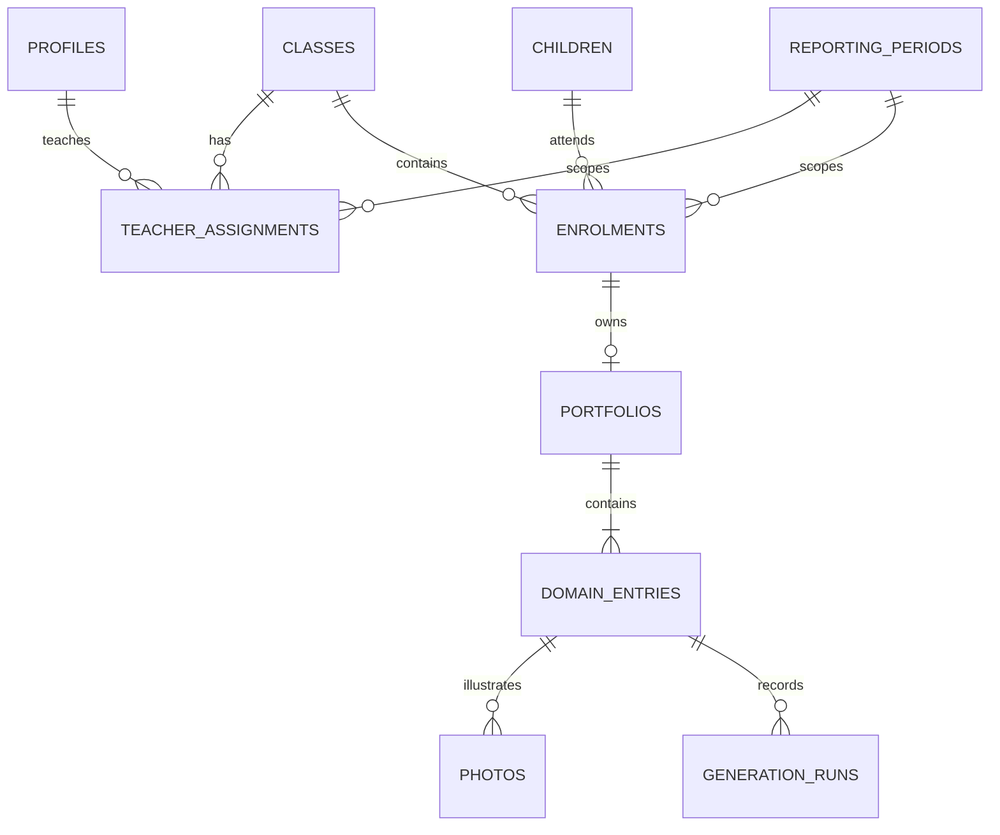

# Riverbay architecture

Status: foundation implementation, 18 October 2026. Fictional data only. See README for verified capabilities and setup.

## Scope and assumptions

One developer builds an internal teacher workspace for one preschool; no 12-month engineering headcount is assumed. Local development changes as needed; deployment cadence is not a production commitment. Zero paid hosting commitment for the prototype. No availability SLA yet. Initial measured targets for later profiling: ordinary save API p95 < 1000 ms locally (excluding AI/uploads/PDF), mobile LCP < 2.5 s / INP < 200 ms / CLS < 0.1; these are targets, not measured results. Production budget and SLO require school agreement. Do not block the prototype on speculative scale planning.

## Components

- Next.js App Router + TypeScript: forms, server actions, access-aware queries.
- Supabase: PostgreSQL, password login, private object storage. Local CLI stack for development; the same migrations can be applied to an approved hosted project. Local CLI is not a production self-host deployment.
- Authenticated server client uses the user's session, preserving database row-level security. Service-role credentials are restricted to the local seed script, never the web application.
- Server-only narrative adapter: selected domain evidence and trusted guideline in; candidate text and checks out. Provider/model selection and benchmarking deferred. No pretending sample text is live AI.
- Export adapter: saved report data -> HTML/CSS -> Chromium PDF, with locally bundled Chinese fonts. Canva would be another adapter over the same data, not a replacement database.
- UI direction: Riverbay Preschool, Riverbank Garden, pastel marker doodles, beaver mascot. Dark readable text and uncluttered forms. Artwork still pending.

## Relationships

One enrolment per child/reporting period; one portfolio per enrolment; one entry per portfolio/domain. A ring is nullable (unassessed) or 1..3 and directly selected, never calculated. Domains: english, chinese, mathematics, social_emotional. English output except Chinese domain (Simplified Chinese) is a provisional default pending school reply.

## Access and administration

Profiles have admin/teacher roles. Roles are provisioned by a trusted seed/invitation process; no public registration or teacher-controlled role changes. Admins manage class/period teacher assignments and student enrolments. The initial UI selects existing seeded children, teachers and classes; user invitations, child creation, deletions and bulk imports are later additions.

Teacher access derives from class + reporting period assignment. Policies cover portfolios, entries, generation metadata and photo records/objects. Assignment removal revokes subsequent access; server reads are uncached. Existing signed URLs may remain valid until expiry, so keep expiry short when uploads are connected. Profile names visible to teachers are limited to their own profile; admin sees all.

An enrolment is period-specific. Moving it within the same semester deliberately moves that semester's portfolio access to the new class. Other semesters are unchanged. Removing a teacher assignment does not delete portfolios. The admin UI must label transfers clearly; it does not offer destructive deletion of historical children or portfolios.

Semester 2 reads only the same child's same-year Semester 1 ratings through a narrow database function after authorizing access to Semester 2. It does not grant access to old comments/photos or require current teachers to hold last semester's assignment. Missing prior ratings remain null. Current sample scale is versioned; future changed scales must be treated as incompatible rather than blindly compared.

## Saving and narrative lifecycle

Domain entries carry a revision number. Saves use compare-and-swap with the expected revision, return a conflict for stale edits, and clear review when content changes. Editing is allowed without AI. Input and narrative remain separate fields. A future AI response must match the captured revision before it can be accepted. Generated candidates and provenance belong in generation_runs; runtime editing cannot forge server-generated run records.

AI/review/export are integration work after the persistent foundation. Final PDF must use the exact saved reviewed revision. An input or wording-guide change invalidates review. Photo changes also invalidate review when connected. Save incomplete work freely; do not fake a completed checker. The full proposed bounded drafting/checking flow is maintained in private planning; submission docs must describe actual implemented checks.

## Boundaries

No photo analysis, assessment inference, Canva editor, background agents, training, vector database or separate Python service. Template layout changes do not require database changes unless new content fields are introduced. Store private object keys, not expiring URLs. Do not log raw notes, names, prompts or provider keys in generic logs.

Official references consulted 18 October 2026:

- https://nextjs.org/docs/app/getting-started/installation
- https://supabase.com/docs/guides/local-development
- https://supabase.com/docs/guides/database/postgres/row-level-security
